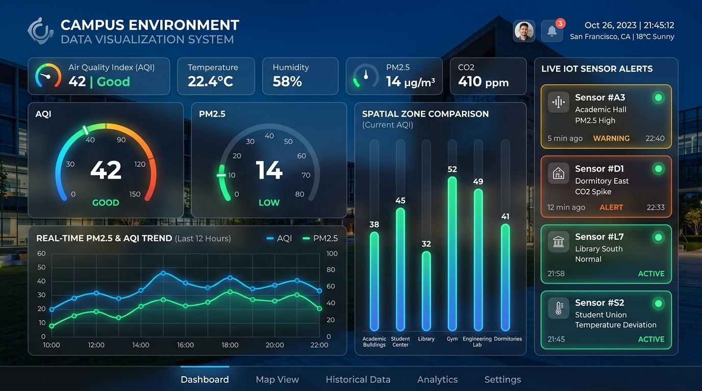
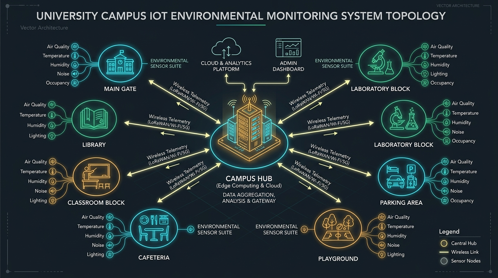

# Campus Environment Data Visualization System

[](https://www.python.org/)
[](https://dash.plotly.com/)
[](https://www.sqlalchemy.org/)
[](https://www.sqlite.org/)
[](https://pytest.org/)
[](https://mtlab1122.github.io/Campus_Environment_DataVisualization_System/)
[](https://vercel.com/new/clone?repository-url=https%3A%2F%2Fgithub.com%2FMTLab1122%2FCampus_Environment_DataVisualization_System)

---

## 1. Project Title and Overview
The **Campus Environment Data Visualization System** is a full-stack Python application engineered to collect, store, process, analyze, and visualize multi-zone ambient and indoor environmental telemetry across educational campus grounds. 

Integrating a high-performance **Flask** web core and an interactive **Plotly Dash** analytical dashboard, the platform enables students, faculty, and campus facility administrators to monitor ambient conditions, identify acoustic and atmospheric anomalies, and review empirical trend reports across multiple campus zones.



---

## 2. Real-Life Problem Statement
Modern university and college campuses host thousands of students, researchers, and staff across diverse functional facilities, such as libraries, crowded dining halls, multi-floor classroom blocks, specialized research laboratories, and outdoor sports grounds. These areas present contrasting environmental challenges:
* **Indoor Air Quality (IAQ) & Cognitive Decline**: Poor ventilation in crowded lecture halls and study libraries leads to rapid accumulation of Carbon Dioxide ($CO_2 > 1000\text{ ppm}$) and fine particulate matter ($PM_{2.5}$), inducing lethargy, headaches, and impaired cognitive retention.
* **Acoustic Pollution**: Unregulated noise in academic libraries and residential dormitories disrupts concentration and restorative sleep.
* **Outdoor & Vehicular Particulates**: Heavy traffic around campus gates and parking lots generates elevated $PM_{10}$ and $PM_{2.5}$ exhaust plumes during morning and evening rush hours.
* **Fragmented Monitoring**: Most institutions lack a unified, automated telemetry framework, relying instead on sporadic manual spot checks that fail to provide real-time alerts or historical insights.



---

## 3. Objectives
1. **Unified Atmospheric & Acoustic Sensing**: Provide a centralized telemetry hub capturing Temperature, Humidity, $PM_{2.5}$, $PM_{10}$, $CO_2$, Noise, and standard US EPA Air Quality Index (AQI).
2. **Multi-Zone Spatial Surveillance**: Support granular monitoring across distinct campus zones (Main Gate, Library, Classroom Block, Cafeteria, Hostel, Playground, Parking Area, Laboratory Block).
3. **Automated Alerting**: Continuously evaluate incoming readings against configurable multi-tiered thresholds (Warning, Poor, Dangerous) with instant dashboard flags and resolution logs.
4. **Rich Interactive Visualizations**: Render publication-quality dynamic charts (multi-trace time trends, zone comparisons, real-time gauges, quartile distributions, diurnal heatmaps, and 5-axis spider radar comparisons).
5. **Campus Environmental Health Index (CEHI)**: Compute a holistic campus safety grade (0–100 score, A+ to F) evaluating AQI, thermal comfort, acoustics, and ventilation.
6. **Periodic Reporting & Open Data Access**: Offer automated daily, weekly, and monthly statistical summaries with direct CSV data exports.

---

## 4. Key Features
* **Role-Based Access Control (RBAC)**:
  * **Admin**: Manage campus zones, provision sensor hardware, configure alert thresholds, ingest manual telemetry, and view audit reports.
  * **Viewer / Public**: View real-time dashboards, filter readings, analyze charts, inspect alert histories, and download CSV reports.
* **Campus Environmental Health Index (CEHI)**: Real-time weighted multi-factor health grade (A+ to F) combining EPA AQI, ASHRAE thermal comfort, and WHO noise guidelines.
* **Multi-Dimensional Radar Matrix Chart**: Interactive Plotly Radar visualization comparing all 8 campus zones across 5 normalized dimensions.
* **Statistical Correlation Matrix**: In-depth Pearson correlation computations identifying relationships between ambient parameters.
* **Interactive REST API Documentation Explorer (`/api/docs`)**: Web-based testing console with single-click live endpoint queries.
* **Realistic Telemetry Simulation**: Built-in mock IoT data generation service implementing solar diurnal equations, inverse humidity curves, and zone-specific occupancy spikes, plus instantaneous pulse firing (`/api/readings/simulate-pulse`).
* **Automated EPA Air Quality Indexing**: Dynamic calculation of AQI based on EPA piecewise linear interpolation for $PM_{2.5}$ and $PM_{10}$.
* **Multi-Dimensional Dashboard Filtering**: Instant filtering by Campus Zone, Primary Parameter, Calendar Date Range, and Daily Hour Window slider.
* **Historical Data Seeding**: Ready-to-run seeder generating 7+ days of realistic hourly telemetry across all campus zones.
* **Automated 100% Passing Test Suite**: 27 unit, integration, and live server tests executing seamlessly via pytest.

---

## 5. Technology Stack (Python-Only)
The entire system is implemented strictly using Python-based technologies:

| Layer | Technology | Purpose |
| :--- | :--- | :--- |
| **Language** | Python 3.10+ (tested on Python 3.15) | Core execution runtime |
| **Web Framework** | Flask 3.1+ | WSGI application, routing, and REST API |
| **Visualization & Dashboard**| Plotly Dash 2.17+ & Dash Bootstrap Components | Interactive reactive dashboard |
| **ORM & Persistence** | SQLAlchemy 2.0+ & Flask-SQLAlchemy | Object-relational mapping and database abstraction |
| **Database Engine** | SQLite 3 | Embedded zero-configuration ACID relational database |
| **Data Science & Analytics** | Pandas 2.2+ & NumPy 1.26+ | DataFrames, rolling metrics, and statistical aggregations |
| **Authentication & Security**| Flask-Login & Werkzeug Security | Session authentication and salted SHA-256 password hashing |
| **Environment Management** | python-dotenv | Secure `.env` configuration parsing |
| **Synthetic Data Generation**| Faker & custom math diurnal model | Realistic sensor data generation |
| **Automated Testing** | Pytest 8.0+ | Unit and integration test suite |

---

## 6. System Architecture

```
                       +----------------------------------+
                       |           Web Browser            |
                       |  (Desktop / Tablet / Mobile UI)  |
                       +----------------------------------+
                                        |
               HTTP GET/POST (HTML / JSON) & Dash Reactive Callbacks
                                        |
                                        v
+-----------------------------------------------------------------------------------+
|                           FLASK WSGI APPLICATION CORE                             |
|                                                                                   |
|  +-----------------------+  +-----------------------+  +----------------------+  |
|  |   Jinja2 Web Views    |  |     REST API Routes   |  |   Plotly Dash App    |  |
|  | - /login, /register   |  | - /api/zones          |  | - URL: /dashboard/   |  |
|  | - /admin/zones        |  | - /api/sensors        |  | - KPI Metric Cards   |  |
|  | - /admin/sensors      |  | - /api/readings       |  | - Interactive Graphs |  |
|  | - /admin/thresholds   |  | - /api/alerts         |  | - Reactive Callbacks |  |
|  | - /admin/manual       |  | - /api/reports        |  | - Filter Controls    |  |
|  +-----------------------+  +-----------------------+  +----------------------+  |
|                                        |                                          |
|                                        v                                          |
|  +-----------------------------------------------------------------------------+  |
|  |                              BUSINESS LOGIC                                 |  |
|  |  +---------------------+ +----------------------+ +----------------------+  |  |
|  |  | Alert Rule Engine   | | Analytics & Pandas   | | EPA AQI Calculator   |  |  |
|  |  +---------------------+ +----------------------+ +----------------------+  |  |
|  +-----------------------------------------------------------------------------+  |
|                                        |                                          |
|                                        v                                          |
|  +-----------------------------------------------------------------------------+  |
|  |                            SQLAlchemy ORM MODELS                            |  |
|  |   User  •  CampusZone  •  Sensor  •  EnvironmentalReading  •  Alert  •  ... |  |
|  +-----------------------------------------------------------------------------+  |
+-----------------------------------------------------------------------------------+
                                         |
                                         v
                         +-------------------------------+
                         |   SQLite Relational Storage   |
                         |    (campus_environment.db)    |
                         +-------------------------------+
```

---

## 7. Folder Structure
The repository adheres to a modular, decoupled architecture:

```
campus-environment-dashboard/
├── README.md                           # Comprehensive documentation and run guide
├── requirements.txt                    # Pinned Python package dependencies
├── .env.example                        # Template environment configuration file
├── .env                                # Local configuration instance
├── run.py                              # Application entry point script
├── config.py                           # Development, Testing, and Production configs
├── docs/
│   ├── thesis.md                       # Complete graduation thesis (University format)
│   ├── system-design.md                # In-depth system architectural design
│   ├── api-documentation.md            # Detailed REST API specification
│   └── screenshots/                    # Interface screenshot placeholders
├── app/
│   ├── __init__.py                     # Application factory (create_app)
│   ├── extensions.py                   # SQLAlchemy and LoginManager instances
│   ├── models/                         # Database schema models
│   │   ├── __init__.py
│   │   ├── user.py                     # User account & RBAC model
│   │   ├── campus_zone.py              # Geographic campus zone model
│   │   ├── sensor.py                   # Hardware telemetry sensor model
│   │   ├── environmental_reading.py    # Time-series environmental readings
│   │   └── alert.py                    # Alert thresholds and violation logs
│   ├── routes/                         # Flask Web & REST API Blueprints
│   │   ├── __init__.py
│   │   ├── auth.py                     # Session login, logout, and token auth
│   │   ├── zones.py                    # Zone CRUD endpoints & admin views
│   │   ├── sensors.py                  # Sensor provisioning & admin views
│   │   ├── readings.py                 # Telemetry ingestion & query endpoints
│   │   ├── alerts.py                   # Threshold customization & alert resolve
│   │   └── reports.py                  # Aggregation reports & CSV downloads
│   ├── services/                       # Business logic services
│   │   ├── __init__.py
│   │   ├── data_generator.py           # Mock IoT telemetry generator & seeder
│   │   ├── analytics.py                # Pandas time-series aggregation & KPIs
│   │   ├── alert_service.py            # Real-time threshold evaluation
│   │   └── report_service.py           # Period reports & CSV formatter
│   ├── dashboard/                      # Plotly Dash analytical application
│   │   ├── __init__.py                 # Dash mounting onto Flask
│   │   ├── layout.py                   # Reactive layout tree
│   │   ├── callbacks.py                # Interactivity and graph updates
│   │   └── components/                 # Reusable UI components
│   │       ├── __init__.py
│   │       ├── navbar.py               # Top navigation bar
│   │       ├── metric_cards.py         # Real-time KPI summaries
│   │       ├── filter_panel.py         # Zone, date, parameter filter controls
│   │       ├── charts.py               # Plotly line, bar, gauge, box, heatmaps
│   │       ├── alerts_table.py         # Active alert notification items
│   │       └── reports_view.py         # Summary report tables
│   ├── templates/                      # Jinja2 HTML templates
│   │   ├── base.html                   # Global layout and navigation wrapper
│   │   ├── login.html                  # User login interface
│   │   ├── register.html               # Viewer registration interface
│   │   ├── admin_zones.html            # Zone management panel
│   │   ├── admin_sensors.html          # Sensor hardware management
│   │   ├── admin_thresholds.html       # Alert rules configuration
│   │   └── manual_entry.html           # Manual telemetry ingestion form
│   ├── static/                         # Static assets
│   │   ├── css/
│   │   │   └── custom.css              # Custom styling, elevations, animations
│   │   └── js/
│   │       └── main.js                 # Client-side utility scripts
│   └── utils/                          # Helper utilities
│       ├── __init__.py
│       ├── aqi_calculator.py           # US EPA piecewise AQI interpolation
│       ├── decorators.py               # RBAC @admin_required guards
│       └── helpers.py                  # API response formatting & datetime parsers
├── seed/
│   ├── __init__.py
│   └── seed_data.py                    # Complete database seeder script
└── tests/                              # Automated test suite
    ├── __init__.py
    ├── conftest.py                     # Pytest fixtures and test database
    ├── test_api.py                     # REST API integration tests
    ├── test_models.py                  # SQLAlchemy entity tests
    └── test_alerts.py                  # Threshold rules and AQI calculation tests
```

---

## 8. Installation Instructions

### Prerequisites
* Python 3.10 or higher installed on your operating system (`python --version`).
* Git command line utility.

### Step 1: Clone or Navigate to Project
```bash
cd campus-environment-dashboard
```

---

## 9. Virtual Environment Setup

### On Windows (PowerShell / Command Prompt)
```powershell
python -m venv venv
.\venv\Scripts\activate
```

### On macOS / Linux
```bash
python3 -m venv venv
source venv/bin/activate
```

### Upgrade pip and install dependencies
```bash
python -m pip install --upgrade pip
pip install -r requirements.txt
```

---

## 10. Environment Variables
Create a local `.env` configuration file from the provided `.env.example`:

```bash
# Windows
copy .env.example .env

# macOS / Linux
cp .env.example .env
```

Contents of `.env`:
```ini
FLASK_APP=run.py
FLASK_ENV=development
FLASK_DEBUG=1
SECRET_KEY=campus-env-secret-key-super-secure-change-in-production-2026
DATABASE_URL=sqlite:///campus_environment.db
PORT=5000
HOST=127.0.0.1
```

---

## 11. Database Setup
The database tables are automatically initialized upon launching the application or running the seeding script. To initialize manually:
```bash
python -c "from app import create_app, db; app = create_app('development'); app.app_context().push(); db.create_all(); print('Database tables created.')"
```

---

## 12. Data Seeding Instructions
Run the automated seeding script to provision system users, the 8 default campus zones, 8 sensor telemetry stations, safety thresholds, and 7 days of realistic historical hourly telemetry:

```bash
python seed/seed_data.py
```

Expected output:
```
Creating database schema tables...
Provisioning system user accounts...
  [+] Created default Admin account: admin / admin123
  [+] Created default Viewer account: viewer / viewer123
Provisioning campus geographic zones...
  [+] Added Campus Zone: Main Gate (ZONE_GATE)
  [+] Added Campus Zone: Library (ZONE_LIB)
  [+] Added Campus Zone: Classroom Block (ZONE_CLASS)
  ...
Configuring safety thresholds...
  [+] Alert thresholds verified.
Generating realistic 7-day time-series telemetry...
Successfully generated 1352 environmental readings.
DATABASE SEEDING COMPLETED SUCCESSFULLY!
```

---

## 13. How to Run the Project
Launch the full web server and integrated Plotly Dash analytical application:

```bash
python run.py
```

Access the system in your web browser:
* **Interactive Dashboard**: `http://127.0.0.1:5000/dashboard/`
* **Admin Zone Management**: `http://127.0.0.1:5000/admin/zones`
* **Admin Sensor Provisioning**: `http://127.0.0.1:5000/admin/sensors`
* **Admin Alert Thresholds**: `http://127.0.0.1:5000/admin/thresholds`
* **Manual Data Ingestion**: `http://127.0.0.1:5000/admin/readings/manual`
* **REST API Root**: `http://127.0.0.1:5000/api/`

---

## 14. Default Login Credentials
For local demonstration and evaluation:

| Account Type | Username | Password | Role | Permissions |
| :--- | :--- | :--- | :--- | :--- |
| **System Administrator** | `admin` | `admin123` | `admin` | Full CRUD zones, sensors, thresholds, manual ingestion |
| **General Viewer** | `viewer` | `viewer123` | `viewer` | View dashboard, filter telemetry, resolve alerts, download reports |

---

## 15. API Documentation Quick Reference
All endpoints use JSON payloads and return structured responses:

| Method | Endpoint | Access | Purpose |
| :--- | :--- | :--- | :--- |
| `POST` | `/api/auth/login` | Public | Authenticate user session |
| `POST` | `/api/auth/logout` | Authenticated | Terminate session |
| `GET` | `/api/auth/me` | Public | Inspect current user session |
| `GET` | `/api/zones` | Public | List all campus zones |
| `POST` | `/api/zones` | Admin | Create a new campus zone |
| `PUT` | `/api/zones/<id>` | Admin | Update campus zone |
| `DELETE`| `/api/zones/<id>` | Admin | Remove campus zone |
| `GET` | `/api/sensors` | Public | List sensors (filter by `zone_id`, `status`) |
| `POST` | `/api/sensors` | Admin | Register new hardware sensor station |
| `GET` | `/api/readings` | Public | Filter telemetry (`zone_id`, `start_date`, etc.) |
| `POST` | `/api/readings` | Public | Ingest sensor telemetry (IoT hardware) |
| `GET` | `/api/readings/latest` | Public | Latest readings for all campus zones |
| `GET` | `/api/alerts` | Public | Query alerts (filter by `severity`, `is_resolved`) |
| `PUT` | `/api/alerts/<id>/resolve` | Public | Mark active alert as resolved |
| `GET` | `/api/alerts/thresholds` | Public | List parameter threshold rules |
| `PUT` | `/api/alerts/thresholds/<id>`| Admin | Update threshold parameters |
| `GET` | `/api/reports/summary` | Public | Daily, weekly, monthly aggregated report |
| `GET` | `/api/reports/export-csv` | Public | Download filtered telemetry CSV file |
| `GET` | `/api/dashboard/stats` | Public | Consolidated real-time metrics |

*For complete payload and schema documentation, see [docs/api-documentation.md](docs/api-documentation.md).*

---

## 16. Dashboard Features
The Plotly Dash dashboard at `/dashboard/` provides:
1. **Air Quality Index (AQI) Banner**: Prominently displays campus composite AQI with dynamic color indicators:
   * **Good (0–50)**: Emerald Green (`#10B981`)
   * **Moderate (51–100)**: Amber (`#F59E0B`)
   * **Poor (101–200)**: Crimson Red (`#EF4444`)
   * **Dangerous (>200)**: Deep Maroon (`#7F1D1D`)
2. **Key Metric Summary Cards**: Displays current values and 24-hour comparative trend percentages for Temperature, Humidity, $PM_{2.5}$, $PM_{10}$, $CO_2$, and Noise.
3. **Interactive Temporal Trend Chart**: Multi-line Plotly visualization with range sliders, time-window buttons, and unified hover tooltips.
4. **Gauge Indicator Dial**: Visualizes current pollutant concentration against safe, warning, and dangerous threshold arcs.
5. **Campus Zone Comparison Bar Chart**: Horizontal bar chart comparing parameter averages across all zones.
6. **Variance Box Plot**: Statistical distribution showing quartiles, medians, and outliers across campus blocks.
7. **Diurnal Heatmap**: Matrix visualization of 24-hour daily cycles across zones.
8. **Interactive Telemetry Table**: Native sorting, column filtering, and pagination for individual sensor records.
9. **One-Click CSV Export**: Download filtered data directly to local disk.

---

## 17. Alert Threshold Rules
Alerts are generated when ingested telemetry violates configured rules:

| Environmental Parameter | Warning Limit | Poor Limit | Dangerous Limit | Primary Risk |
| :--- | :--- | :--- | :--- | :--- |
| **Fine Particulates ($PM_{2.5}$)** | $> 25.0\text{ }\mu\text{g/m}^3$ | $> 35.0\text{ }\mu\text{g/m}^3$ | $> 55.0\text{ }\mu\text{g/m}^3$ | Respiratory irritation, asthma |
| **Coarse Particulates ($PM_{10}$)** | $> 50.0\text{ }\mu\text{g/m}^3$ | $> 100.0\text{ }\mu\text{g/m}^3$ | $> 150.0\text{ }\mu\text{g/m}^3$ | Airborne dust, vehicular exhaust |
| **Carbon Dioxide ($CO_2$)** | $> 800\text{ ppm}$ | $> 1000\text{ ppm}$ | $> 2000\text{ ppm}$ | Lethargy, cognitive fatigue |
| **Acoustic Noise** | $> 65.0\text{ dB}$ | $> 70.0\text{ dB}$ | $> 85.0\text{ dB}$ | Study disruption, hearing fatigue |
| **Ambient Temperature** | $< 18^\circ\text{C}$ or $> 30^\circ\text{C}$ | $< 14^\circ\text{C}$ or $> 35^\circ\text{C}$ | $< 10^\circ\text{C}$ or $> 40^\circ\text{C}$ | Heat stress, thermal discomfort |
| **Relative Humidity** | $< 30\%$ or $> 70\%$ | $< 20\%$ or $> 80\%$ | $< 15\%$ or $> 90\%$ | Mold growth, skin dryness |

---

## 18. Screenshot Placeholders
Screenshots demonstrating the working system are organized in `docs/screenshots/`:
* `docs/screenshots/dashboard_overview.png`: Main dashboard showing metric cards, AQI status, and trend charts.
* `docs/screenshots/charts_comparison.png`: Zone comparison bar chart, distribution box plot, and diurnal heatmap.
* `docs/screenshots/alerts_panel.png`: Active environmental alerts and resolution controls.
* `docs/screenshots/admin_zones.png`: Admin zone management interface.
* `docs/screenshots/manual_entry.png`: Manual telemetry ingestion interface.

---

## 19. Testing Instructions
The test suite includes unit tests for SQLAlchemy models, alert rules, and AQI calculations, plus integration tests for all REST API endpoints.

Execute the test suite with pytest:
```bash
pytest -v
```

Expected output:
```
============================= test session starts =============================
platform win32 -- Python 3.15.0, pytest-9.1.1
collected 17 items

tests/test_alerts.py::test_aqi_calculation PASSED                        [  5%]
tests/test_alerts.py::test_alert_rule_evaluation PASSED                  [ 11%]
tests/test_alerts.py::test_alert_resolution PASSED                       [ 17%]
tests/test_api.py::test_auth_login_and_me PASSED                         [ 23%]
tests/test_api.py::test_get_zones PASSED                                 [ 29%]
tests/test_api.py::test_create_zone_unauthenticated PASSED               [ 35%]
tests/test_api.py::test_create_zone_forbidden_for_viewer PASSED          [ 41%]
tests/test_api.py::test_create_zone_admin_success PASSED                 [ 47%]
tests/test_api.py::test_sensor_endpoints PASSED                          [ 52%]
tests/test_api.py::test_telemetry_reading_ingestion PASSED               [ 58%]
tests/test_api.py::test_get_readings_with_filters PASSED                 [ 64%]
tests/test_api.py::test_dashboard_stats_and_reports PASSED               [ 70%]
tests/test_models.py::test_user_password_hashing PASSED                  [ 76%]
tests/test_models.py::test_admin_user_role PASSED                        [ 82%]
tests/test_models.py::test_campus_zone_model PASSED                      [ 88%]
tests/test_models.py::test_sensor_and_reading_relationship PASSED        [ 94%]
tests/test_models.py::test_alert_model PASSED                            [100%]

====================== 17 passed in 8.65s =======================
```

---

## 20. Future Improvements
1. **MQTT & LoRaWAN Gateway Integration**: Add an MQTT broker bridge (such as Eclipse Mosquitto) for direct sensor transmission from ESP32 / Arduino microcontrollers over low-power LoRaWAN networks.
2. **Machine Learning Predictive Forecasting**: Train ARIMA or LSTM neural network models in Python to forecast particulate concentrations 24 hours in advance.
3. **Automated Notification Dispatch**: Integrate Webhooks, SMS (Twilio), or email alerts to campus security when Dangerous thresholds are exceeded.
4. **Geographic GIS Mapping**: Embed a Leaflet or Mapbox interactive campus map showing real-time sensor node positions and air quality heat plumes.

---

## 21. License
This project is open-source and released under the **MIT License**. You are free to modify, distribute, and integrate this software into institutional and educational deployments.
