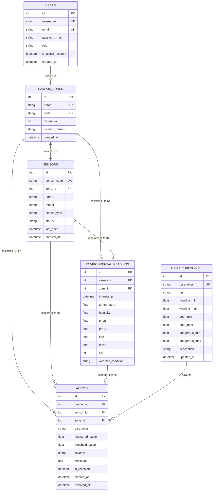

# Campus Environment Data Visualization System — System Design Document

## 1. Executive Architecture Summary

The **Campus Environment Data Visualization System** is an end-to-end, Python-centric software architecture developed to aggregate, process, analyze, and visually communicate ambient environmental telemetry across institutional campus grounds. Designed to monitor critical parameters—including Temperature, Relative Humidity, Fine Particulate Matter (PM2.5), Coarse Particulate Matter (PM10), Carbon Dioxide (CO2), Acoustic Noise levels, and standard US EPA Air Quality Index (AQI)—the system bridges IoT sensor hardware ingestion with analytical decision dashboards.

```
+-------------------------------------------------------------------------------------------------------+
|                                           PRESENTATION LAYER                                          |
|                                                                                                       |
|  +-------------------------------------+   +-------------------------------------------------------+  |
|  |     Flask Administrative Views      |   |            Plotly Dash Analytical Dashboard           |  |
|  | (Jinja2, Bootstrap 5, Custom CSS)   |   |   - Real-Time KPI Cards    - Diurnal Heatmap Matrix   |  |
|  | - Zone Management   - Sensor Provision |   |   - Interactive Time Trend - Distribution Box Plot     |  |
|  | - Threshold Config  - Manual Ingest |   |   - Zone Bar Comparisons   - Filterable Data Table    |  |
|  +-------------------------------------+   +-------------------------------------------------------+  |
+-------------------------------------------------------------------------------------------------------+
                                                     |
                                                     v
+-------------------------------------------------------------------------------------------------------+
|                                        APPLICATION & API ROUTING                                      |
|                                                                                                       |
|  +-------------------------------------------------------------------------------------------------+  |
|  |                                  Flask WSGI Application Layer                                   |  |
|  |  +-------------------+  +-------------------+  +-------------------+  +----------------------+  |  |
|  |  |   Auth Blueprint  |  |  Zones Blueprint  |  | Sensors Blueprint |  |  Readings Blueprint  |  |  |
|  |  +-------------------+  +-------------------+  +-------------------+  +----------------------+  |  |
|  |  |  Alerts Blueprint |  | Reports Blueprint |  | RBAC Middleware   |  | API Error Handlers   |  |  |
|  |  +-------------------+  +-------------------+  +-------------------+  +----------------------+  |  |
|  +-------------------------------------------------------------------------------------------------+  |
+-------------------------------------------------------------------------------------------------------+
                                                     |
                                                     v
+-------------------------------------------------------------------------------------------------------+
|                                      BUSINESS LOGIC & ANALYTICS                                       |
|                                                                                                       |
|  +---------------------+  +---------------------+  +---------------------+  +----------------------+  |
|  | Telemetry Generator |  | EPA AQI Calculator  |  |   Analytics Engine  |  |    Alert Service     |  |
|  | - Diurnal Equations |  | - Linear Breakpoints|  | - Pandas Statistics|  | - Threshold Engine   |  |
|  | - Zone Behaviors    |  | - Category Mapping  |  | - Matrix Aggregation|  | - Lifecycle State    |  |
|  +---------------------+  +---------------------+  +---------------------+  +----------------------+  |
+-------------------------------------------------------------------------------------------------------+
                                                     |
                                                     v
+-------------------------------------------------------------------------------------------------------+
|                                            PERSISTENCE LAYER                                          |
|                                                                                                       |
|  +-------------------------------------------------------------------------------------------------+  |
|  |                             SQLAlchemy 2.0 ORM Object-Relational Layer                          |  |
|  |  +---------------+  +---------------+  +---------------+  +------------------+  +-------------+ |  |
|  |  |  User Model   |  |CampusZone Model| |  Sensor Model |  |EnvReading Model  |  | Alert Models| |  |
|  |  +---------------+  +---------------+  +---------------+  +------------------+  +-------------+ |  |
|  +-------------------------------------------------------------------------------------------------+  |
|                                                     |                                                 |
|                                                     v                                                 |
|  +-------------------------------------------------------------------------------------------------+  |
|  |                          SQLite Embedded Relational Database Engine                             |  |
|  |                               (campus_environment.db / in-memory)                               |  |
|  +-------------------------------------------------------------------------------------------------+  |
+-------------------------------------------------------------------------------------------------------+
```

---

## 2. Relational Database Design

The data persistence schema is structured around six core relational entities normalized to Third Normal Form (3NF), minimizing redundancy while preserving historical sensor audit trails.

### 2.1 Entity Relationship Diagram (ERD)



### 2.2 Table Specifications

#### 1. `users`
Stores administrative and viewing accounts for system authentication and role-based permissions.
* `id` (INTEGER, Primary Key, Auto Increment)
* `username` (VARCHAR(64), Unique, Not Null, Indexed)
* `email` (VARCHAR(120), Unique, Not Null, Indexed)
* `password_hash` (VARCHAR(256), Not Null)
* `role` (VARCHAR(20), Not Null, Default: `'viewer'`) — Values: `'admin'`, `'viewer'`
* `is_active_account` (BOOLEAN, Default: `True`)
* `created_at` (DATETIME, Default: `utcnow`)

#### 2. `campus_zones`
Delineates physical zones across campus facilities.
* `id` (INTEGER, Primary Key, Auto Increment)
* `name` (VARCHAR(100), Unique, Not Null, Indexed)
* `code` (VARCHAR(30), Unique, Not Null, Indexed) — e.g., `ZONE_LIB`, `ZONE_GATE`
* `description` (TEXT, Nullable)
* `location_details` (VARCHAR(255), Nullable)
* `created_at` (DATETIME, Default: `utcnow`)

#### 3. `sensors`
Encapsulates IoT sensory telemetry hardware stations.
* `id` (INTEGER, Primary Key, Auto Increment)
* `sensor_code` (VARCHAR(50), Unique, Not Null, Indexed) — e.g., `ENV-SN-LIB-01`
* `zone_id` (INTEGER, Foreign Key -> `campus_zones.id` ON DELETE CASCADE, Indexed)
* `name` (VARCHAR(100), Not Null)
* `model` (VARCHAR(60), Not Null, Default: `'CampusSense-IoT-v2.1'`)
* `sensor_type` (VARCHAR(80), Default: `'Multi-Parameter Environmental Station'`)
* `status` (VARCHAR(20), Default: `'online'`) — Values: `'online'`, `'offline'`, `'maintenance'`
* `last_seen` (DATETIME, Nullable)
* `created_at` (DATETIME, Default: `utcnow`)

#### 4. `environmental_readings`
Time-series storage for continuous atmospheric and acoustic telemetry.
* `id` (INTEGER, Primary Key, Auto Increment)
* `sensor_id` (INTEGER, Foreign Key -> `sensors.id` ON DELETE CASCADE, Indexed)
* `zone_id` (INTEGER, Foreign Key -> `campus_zones.id` ON DELETE CASCADE, Indexed)
* `timestamp` (DATETIME, Not Null, Indexed)
* `temperature` (FLOAT, Not Null) — °C
* `humidity` (FLOAT, Not Null) — %
* `pm25` (FLOAT, Not Null) — µg/m³
* `pm10` (FLOAT, Not Null) — µg/m³
* `co2` (FLOAT, Not Null) — ppm
* `noise` (FLOAT, Not Null) — dB
* `aqi` (INTEGER, Not Null) — Calculated US EPA Index
* `weather_condition` (VARCHAR(50), Default: `'Clear'`)

#### 5. `alert_thresholds`
Safety limits for campus environmental metrics.
* `id` (INTEGER, Primary Key, Auto Increment)
* `parameter` (VARCHAR(50), Unique, Not Null, Indexed) — e.g., `'pm25'`, `'noise'`
* `unit` (VARCHAR(20), Not Null)
* `warning_min` / `warning_max` (FLOAT, Nullable)
* `poor_min` / `poor_max` (FLOAT, Nullable)
* `dangerous_min` / `dangerous_max` (FLOAT, Nullable)
* `description` (VARCHAR(255), Nullable)
* `updated_at` (DATETIME, Default: `utcnow`, OnUpdate: `utcnow`)

#### 6. `alerts`
Persistent log of abnormal environmental episodes and resolutions.
* `id` (INTEGER, Primary Key, Auto Increment)
* `reading_id` (INTEGER, Foreign Key -> `environmental_readings.id` ON DELETE SET NULL, Indexed)
* `sensor_id` (INTEGER, Foreign Key -> `sensors.id` ON DELETE CASCADE, Indexed)
* `zone_id` (INTEGER, Foreign Key -> `campus_zones.id` ON DELETE CASCADE, Indexed)
* `parameter` (VARCHAR(50), Not Null, Indexed)
* `measured_value` (FLOAT, Not Null)
* `threshold_value` (FLOAT, Not Null)
* `severity` (VARCHAR(20), Not Null, Indexed) — `'Warning'`, `'Poor'`, `'Dangerous'`
* `message` (TEXT, Not Null)
* `is_resolved` (BOOLEAN, Default: `False`, Indexed)
* `created_at` (DATETIME, Default: `utcnow`, Indexed)
* `resolved_at` (DATETIME, Nullable)

---

## 3. Data Processing and Ingestion Engine

### 3.1 Mathematical Diurnal Model
To emulate real-life campus dynamics without physical hardware connected, the simulation service implements a continuous solar diurnal cycle combined with occupant activity models:

$$T(h) = T_{\text{base}} + A_{\text{solar}} \cdot \sin\left(\frac{2\pi(h - 9)}{24}\right) + \delta_{\text{occupancy}} + \epsilon$$

Where:
* $h$ represents the local solar hour ($0 \le h < 24$).
* $A_{\text{solar}}$ denotes diurnal thermal amplitude ($1.5^\circ\text{C}$ for HVAC-buffered indoor blocks, $5.0^\circ\text{C}$ for open outdoor areas).
* $\delta_{\text{occupancy}}$ captures human metabolic and culinary heat release during active peak hours (e.g., Cafeteria lunch periods or Classroom lectures).
* $\epsilon$ is a Gaussian stochastic perturbation.

Relative Humidity is modeled with an inverse thermal coupling equation, reflecting physical saturation vapor pressure relationships:

$$RH(h) = RH_{\text{base}} - \alpha \cdot \Delta T(h) + \epsilon_{RH}$$

### 3.2 Air Quality Index (AQI) Calculation Pipeline
AQI calculation adheres to standard United States Environmental Protection Agency (US EPA) piecewise linear interpolation:

$$I_p = \frac{I_{\text{high}} - I_{\text{low}}}{C_{\text{high}} - C_{\text{low}}} (C_p - C_{\text{low}}) + I_{\text{low}}$$

Composite Air Quality Index is derived as the dominant pollutant maximum:

$$\text{AQI} = \max(I_{\text{PM2.5}}, I_{\text{PM10}})$$

---

## 4. Analytical Visualization Pipeline (Plotly Dash)

The interactive dashboard integrates inside the Flask server instance via WSGI dispatch:
1. **Unidirectional Reactive Flow**: User filter interactions (Zone selector, Parameter dropdown, Date Range Picker, Time Range Slider) emit callback events.
2. **Pandas Vectorized Aggregation**: SQL queries pull filtered subsets into a Pandas DataFrame for vectorized grouping and rolling statistical evaluations.
3. **Multi-Trace Rendering**: Plotly graph objects compile client-side WebGL and SVG visualizations (temporal scatter lines, horizontal ranking bars, gauge dials, quartile box plots, and diurnal heatmaps).
4. **Reactive State Stores**: `dcc.Store` and `dcc.Interval` components maintain asynchronous report period state and live telemetry streaming intervals.
